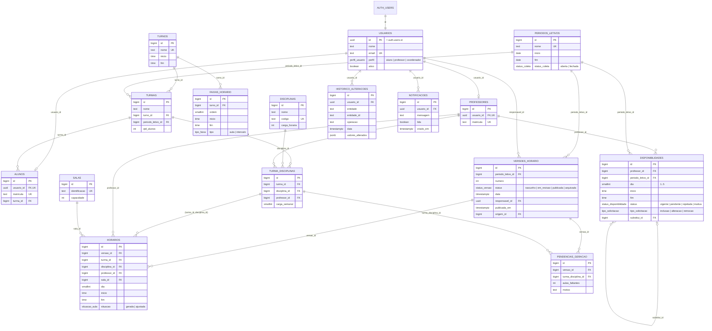

# DER — Modelo de dados

Fonte: [`database/schema.sql`](../database/schema.sql). O diagrama abaixo é renderizado pelo GitHub (Mermaid).

## Integridade garantida pelo banco

| Regra | Mecanismo |
|---|---|
| RN07 — uma versão publicada por período | índice único parcial `versoes_uma_publicada_por_periodo` |
| RN10 — professor sem aulas simultâneas | `unique (versao_id, professor_id, dia, inicio)` |
| RN11 — sala sem duas turmas no mesmo horário | `unique (versao_id, sala_id, dia, inicio)` |
| RN12 — turma sem duas disciplinas ao mesmo tempo | `unique (versao_id, turma_id, dia, inicio)` |
| Aula só de disciplina vinculada à turma | FK composta `horarios (turma_id, disciplina_id) → turma_disciplinas` |
| RN04 — dia útil e intervalo válido | `check (dia between 1 and 5)`, `check (inicio < fim)` |
| Solicitação pendente tipada | `check (status <> 'pendente' or tipo_solicitacao is not null)` |
| Banco inacessível pela Data API | RLS habilitado em todas as tabelas, sem policies; `revoke` para `anon`/`authenticated` |

Os índices únicos funcionam porque as aulas sempre ocupam faixas discretas do turno (validado na API), então dois choques no mesmo dia necessariamente têm o mesmo `inicio`.
